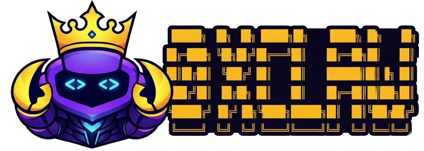

<div align="center">
  
  <br /><br />
  <a href="https://0xclaw-ai.github.io"></a>
  &nbsp;
  <a href="https://github.com/0xclaw-ai/0xClaw"></a>
  &nbsp;
  <a href="https://github.com/0xclaw-ai/0xClaw/blob/master/LICENSE"></a>
</div>

---

Landing page for [0xClaw](https://github.com/0xclaw-ai/0xClaw) — Autonomous AI Hackathon Agent.

## Development

Single-file static site. No build step required.

```bash
# Serve locally
npx serve .
# or
python3 -m http.server 8080
```

## Deploy

Push to `main`. GitHub Pages auto-deploys from repository root.

> Settings → Pages → Source: `Deploy from a branch` → `main` / `(root)`

## Structure

```
.
├── index.html            # Single page
├── assets/
│   ├── 0xclaw_logo.png
│   └── 0xClaw_combine.png
└── README.md
```

## License

📜 [MIT License](LICENSE)